# Языки программирования

## Лабораторная работа 10

## Задание 1 (2)

Рассмотрите следующие фрагменты программ. Запишите, что означают символы & и * в каждом случае применения.

```cpp
int a = 10, b = 20;
int *p = &a , *q = &b;
p = q;
std::cout << *p <<' '<< *q << std::endl;
```

```cpp
int a = 10, b = 20;
int *p = &a , *q = &b;
*p = *q;
std::cout << *p <<' '<< *q << std::endl;
```

Чем различаются присваивания в третьей строке? Что можно вывести, чтобы показать различия?

Примеры программ сохраните в папке с номером задания. Скриншоты работы прикрепите к отчету.

Звездочка в объявлении переменной означает описатель указателя
Звездочка в выражении оператор разыменования.
Оператор взятия адреса &
В первом p и q указывают на одну переменную (присваивается адрес), а во втором присваивается значение.
Разницу можно показать, если вывести сами p и q и адреса &a, &b.

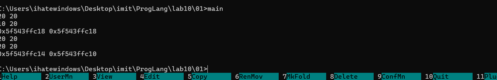

## Задание 2 (1)

Рассмотрим следующую программу.

```cpp
double x[10];
for (int i = 0; i <10; i++)
    std::cout << &x[i] << std::endl;
```

Что она выводит? Измените вывод так, чтобы адреса выводились в десятичной системе счисления. Объясните почему числа составляют арифметическую прогрессию с определенным шагом.

Записанную программу сохраните в папке с номером задания. Скриншоты работы прикрепите к отчету.

Вывод адреса, прогрессия по 8 т.к ячейки по 8 байт
Для десятичного вывода reinterpret_cast<size_t>(&x[i]).

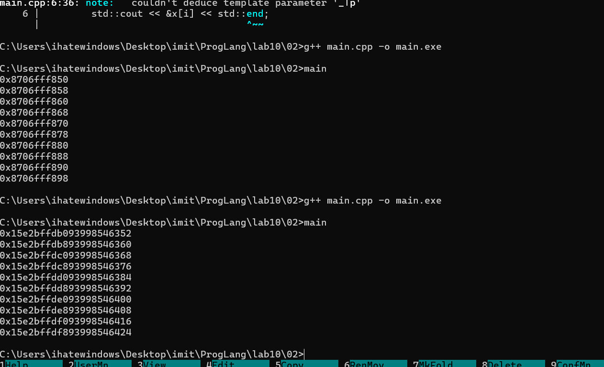

## Задание 3 (2)

Токен «*» в языке C++ может использоваться в трех различных случаях. Аналогично токен «&» также может использоваться в трех случаях. Приведите пример одной программы в которой они были бы использованы во всех случаях.

Записанную программу сохраните в папке с номером задания.

```cpp
#include <iostream>
int main() {
    int a = 6, b = 3;
    int *p = &a;
    int &r = b;
    *p = *p * b;
    int c = a & b;
    std::cout << *p << ' ' << r << ' ' << c << std::endl;
}
```

* `int *p`: * это описатель указателя
* `&a`: & это взятие адреса
* `int &r`: & это описатель ссылки
* `*p = *p * b`: первые два * это разыменование, третий * это умножение
* `a & b`: & это побитовое и

Выводит 18 3 2.

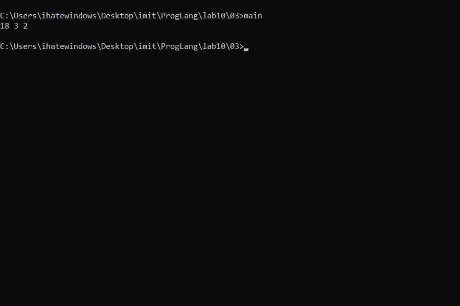

## Задание 4 (2)

Выпишите значения всех переменных, в том числе указателей, после выполнения каждой инструкции программы. Объясните, что происходит в результате выполнения каждой инструкции.

```cpp
unsigned a = 8, b = 3 ,c = 17;
unsigned *p = &a;
unsigned *q = &b;
*p += *q + c;
c = *q;
p = &c;
c += a;
*p += 10;
*q = *p;
q = p ;
*q += 10;
```

* `unsigned *p = &a`: p указывает на a
* `unsigned *q = &b`: q указывает на b
* `*p += *q + c`: a = 8 + 3 + 17 = 28
* `c = *q`: c = 3
* `p = &c`: p теперь указывает на c
* `c += a`: c = 3 + 28 = 31
* `*p += 10`: c = 41, т.к p на c
* `*q = *p`: b = 41, q еще на b
* `q = p`: q теперь тоже на c
* `*q += 10`: c = 51

В конце a = 28, b = 41, c = 51, p и q оба указывают на c.

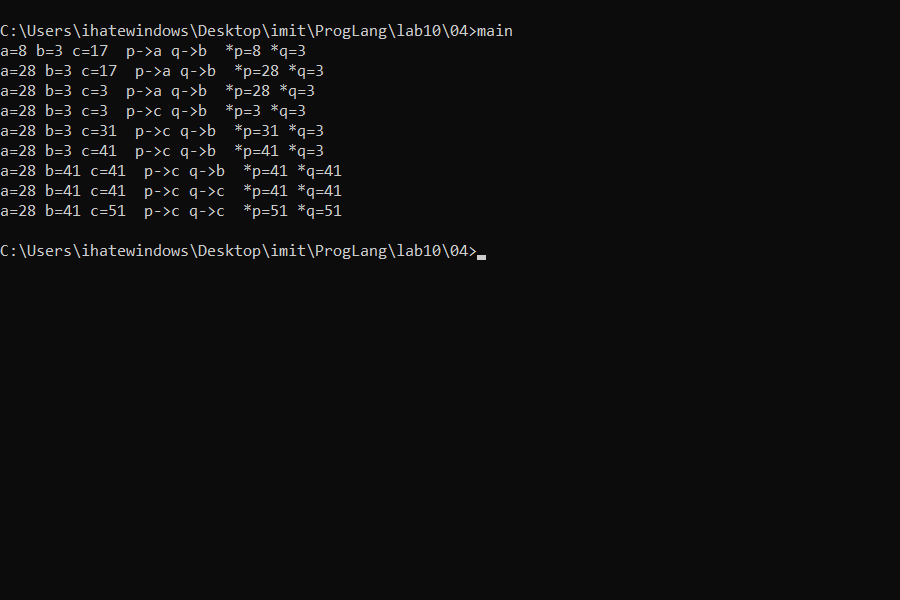

## Задание 5 (1)

Что сравнивается в приведенной ниже программе? Как можно изменить первую строчку программы, чтобы результат тоже изменился?

```cpp
int x = 1, y = 2;
int *p = &y, *q = &x;
if (p < q)
    std::cout << "Yes";
else
    std::cout << "No";
```

Сравниваются адреса, у Y адрес меньше, чем у X
Можно поменять порядок объявления переменных, или дописать static к x

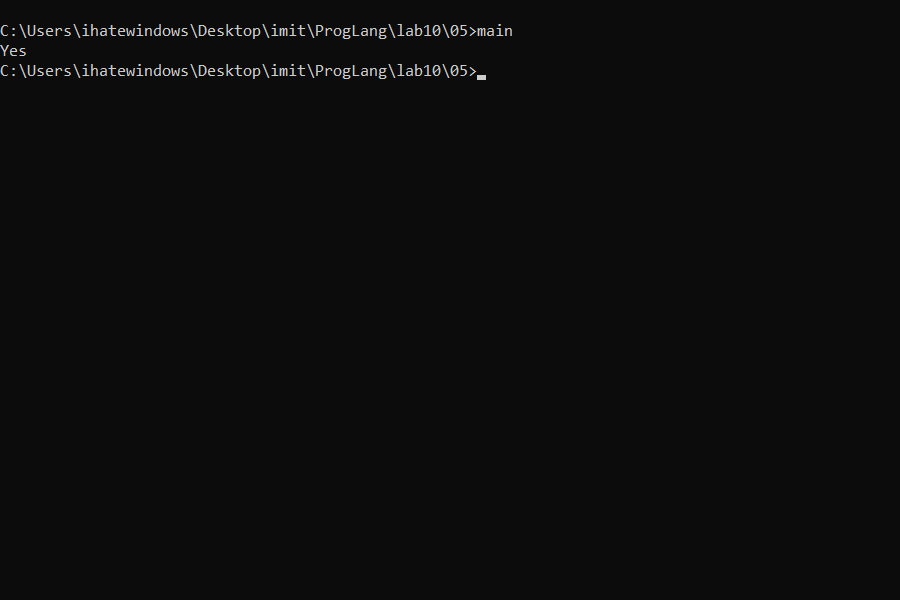

## Задание 6 (2)

Объясните работу следующей программы. Как изменится результат, если тип double изменить на некоторый другой, например int или char?

```cpp
double x = 0;
double *d = &x;
std::cout << reinterpret_cast<size_t>(d + 4) - reinterpret_cast<size_t>(d - 4) << std::endl;
```

Указатель смещается на размер типа, а не на само число. Если сменить на инт будет меньше на 32

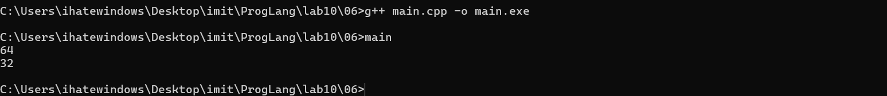

## Задание 7 (2)

Объясните работу следующей программы. Как изменится результат, если тип double изменить на некоторый другой, например int или char?

```cpp
std::cout << reinterpret_cast <double*>(3000) - reinterpret_cast <double*>(2000) << std::endl;
```

reinterpret_cast в обратную сторону. Указателя на 3000 нет. Вычитание двух указателей делится на размер типа: 3000 - 2000 = 1000 / 8 = 125 - количество элементов типа дабл в 1000 байтах

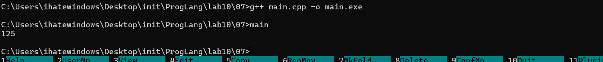

## Задание 8 (2)

Что надо дописать в записанной ниже программе вместо многоточий, чтобы она выводила все числа из массива a? Почему?

```cpp
#include <iostream>
int main() {
    int a[20];
    for (int i = 0; i < 20; i++)
        a[i] = i;
    int *b = a + 8;
    for (int i = -8; i < 12; i++)
        std::cout << b[i] << ' ';
}
```

Нужно дописать 12 (i < 12), так как b сдвинут на 8 элементов (b[i] это a[8 + i]), а последний индекс массива равен 19. Начинать надо с -8, т.к b[-8] это a[0].

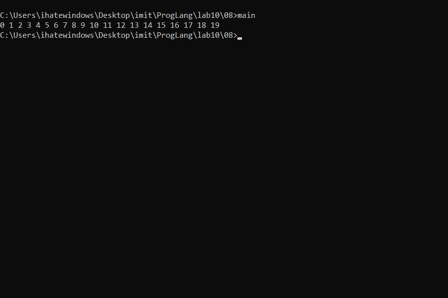

## Задание 9 (2)

Что выводит следующая программа? Изменится ли результат если изменить тип элементов массива?

```cpp
int a[10];
std::cout << &a[8] - &a[3] << std::endl;
```

Выводит 5. Разность указателей считается в элементах, а не в байтах, поэтому при смене типа результат не изменится.

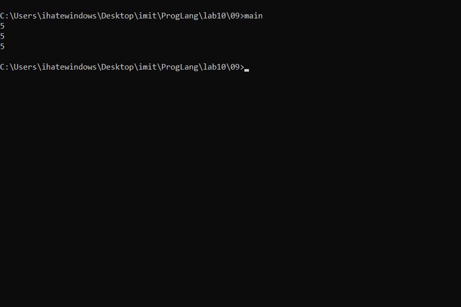

## Задание 10 (1)

Есть ли разница между инициализацией p и q в следующей программе? Обоснуйте ответ.

```cpp
int x [10]={1, 2, 3, 4, 5, 6, 7, 8, 9, 10};
int *p = x + 5;
int *q = &x[5];
```

Разницы нет. x[i] это *(x + i), поэтому &x[5] и x + 5 дают один и тот же адрес.

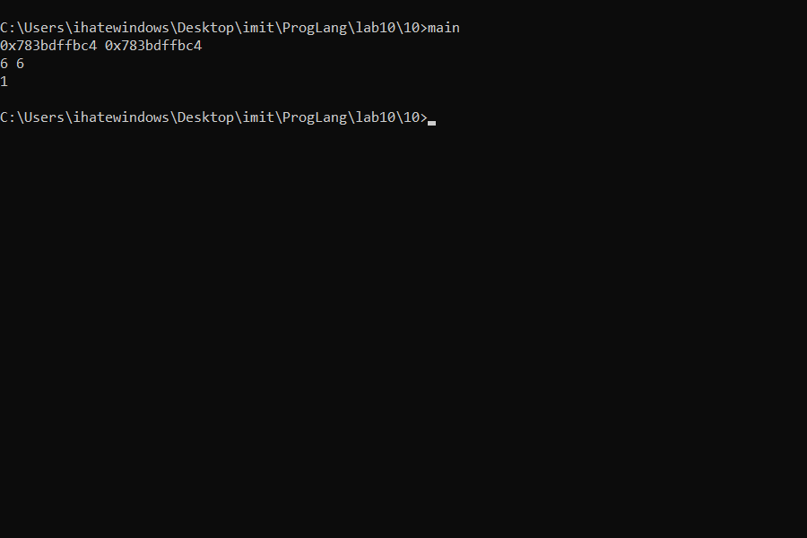

## Задание 11 (3)

Указатели можно использовать для итерации по массивам. Напишите программу, которая найдет сумму элементов массива, используя указатели. В начале цикла указатель требуется установить на начало массива, в конце каждой итерации смещать его к следующему элементу массива через инкремент. Для выхода из цикла надо проверять, что указатель дошел до конца массива.

```cpp
#include <iostream>
int main() {
    int x [10]={1, 2, 3, 4, 5, 6, 7, 8, 9, 10};
    int s = 0;
    for (int *p = x; p < x+10 ;p++)
        s += *p;
    std::cout << s;
}
```

Записанную программу сохраните в папке с номером задания.

Выводит 55.

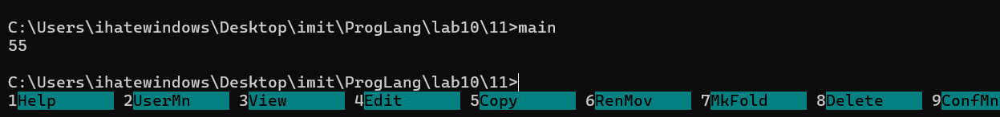

## Дополнительные задания

## Задание 1 (3)

Запишите программу на С++, в которой будет создаваться двумерный массив x[10][10]. Выведите адреса элементов массива и нарисуйте, как элементы расположены в памяти.
    